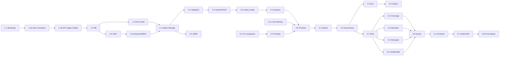

# Spółdzielnia AI — Implementation Plan Overview

This directory breaks [`PLAN.md`](../../PLAN.md) into **commit-sized chunks**. Each chunk is
one unit of work for the agent workflow in [`AGENTS.md`](../../AGENTS.md): code, tests,
`ruff` + `pyright` + `pytest` green, mark done, commit.

**Runtime model:** the platform is a **web app running from Docker images**, a multi-image
`docker compose` stack behind one HTTPS reverse proxy. It runs in Docker from Stage 1 onward
(Mac dev → Linux server). Full design: [DEPLOYMENT_DOCKER.md](DEPLOYMENT_DOCKER.md).

| File | Stage |
|---|---|
| [DEPLOYMENT_DOCKER.md](DEPLOYMENT_DOCKER.md) | Cross-cutting: images, compose, networks, HTTPS, secrets, deploy |
| [01_FOUNDATION_AUTH_RLS.md](01_FOUNDATION_AUTH_RLS.md) | Stage 1: Foundation, OIDC, Postgres RLS |
| [02_UPLOADS_SSRF_MEDIA.md](02_UPLOADS_SSRF_MEDIA.md) | Stage 2: Secure uploads, SSRF, media pipeline |
| [03_PII_INJECTION_PROMOTION.md](03_PII_INJECTION_PROMOTION.md) | Stage 3: PII scrubbing, prompt injection, Push-to-Wiki |
| [04_GOVERNANCE_CONSENT_QDRANT.md](04_GOVERNANCE_CONSENT_QDRANT.md) | Stage 4: Governance, Exit Strategy, Qdrant |
| [05_ANTI_DISTILLATION_RAG.md](05_ANTI_DISTILLATION_RAG.md) | Stage 5: Anti-Distillation Shield, secure RAG |
| [06_FRONTEND_AUDIT.md](06_FRONTEND_AUDIT.md) | Stage 6: Frontend, web security headers, final audit |

---

## 1. Target Repository Layout

A single Python project at the repo root (so the `uv run …` commands in `AGENTS.md` work
unchanged). The frontend and infra live alongside it.

```
SpodzielniaAI/
├── pyproject.toml            # uv project; extras `ml`, `media`; ruff, pyright (strict), pytest
├── uv.lock
├── alembic.ini
├── compose.yaml              # base stack (prod-like)
├── compose.dev.yaml          # Mac dev overrides (build, watch, debug ports, host-Ollama proxy)
├── compose.prod.yaml         # Linux server overrides (registry images, ACME, limits)
├── compose.gpu.yaml          # NVIDIA reservations (Linux)
├── docker-bake.hcl           # multi-arch builds of all targets
├── Makefile                  # up, watch, smoke, secrets, models, deploy, backup
├── .dockerignore
├── docker/backend.Dockerfile # targets: api, worker-core, worker-media
├── secrets/                  # generated, gitignored (Docker secrets)
├── src/spoldzielnia_ai/
│   ├── main.py               # FastAPI app factory
│   ├── core/                 # settings (pydantic-settings), logging, errors, ids
│   ├── db/                   # engine, RLS session, models/, migrations/
│   ├── auth/                 # OIDC (BFF), sessions, refresh rotation, deps, MFA
│   ├── audit/                # SecurityAuditLog service (hash chain)
│   ├── api/                  # routers: auth, notes, uploads, wiki, reviews,
│   │                         #          contributions, rag, admin
│   ├── files/                # magic-bytes validation, archive guard, ClamAV, EXIF, storage
│   ├── net/                  # SSRF-safe fetcher
│   ├── workers/              # Celery app + tasks (transcribe, vlm, parse)
│   ├── privacy/              # Presidio engine + Polish recognizers
│   ├── llm/                  # LiteLLM gateway (force_local_llm), prompt builder, injection guard
│   ├── wiki/                 # promotion, governance state machine, consent / exit strategy
│   ├── vector/               # Qdrant client, collections, embedding, repositories
│   ├── rag/                  # RAGService, schemas
│   └── shield/               # AntiDistillationGuard + CoverageTracker, SemanticAnomalyDetector,
│                             # HoneypotInjector, OutputVerifier, Watermarker, RiskEngine
├── tests/
│   ├── unit/                 # no external services
│   ├── integration/          # testcontainers / docker compose (marker: integration)
│   └── fixtures/             # generated PDFs, images, JWKS keys, corpora
├── infra/
│   ├── caddy/Caddyfile       # single origin: / → frontend, /api → api, auth.* → keycloak
│   ├── keycloak/realm-spoldzielnia.json
│   ├── qdrant/config.yaml
│   ├── postgres/init/        # role + database bootstrap (reads Docker secrets)
│   └── scripts/              # gen-dev-certs.sh, init-secrets.sh, smoke.sh, deploy.sh, backup.sh
└── frontend/                 # Next.js (App Router, TS, Tailwind) + Dockerfile — Stage 6
```

---

## 2. Cross-Cutting Conventions (apply to every chunk)

### 2.1 Definition of Done (per chunk)
1. Code + unit tests (+ integration tests where the chunk touches Postgres/Redis/Qdrant).
2. `uv run ruff check --fix . && uv run ruff format .` — clean.
3. `uv run pyright` — **0 errors** in strict mode.
4. `uv run pytest` — green (integration tests run when Docker is available; see 2.3).
5. **Docker gate** (from chunk 1.2b on, whenever a chunk touches dependencies, Dockerfiles,
   compose files, settings/secrets or entry points): `make build && make up && make smoke` green.
   The stack must boot healthy and answer at `https://spoldzielnia.localhost`.
6. Tick the chunk checkbox in this file **and** in `PLAN.md`, then `git commit`
   with message `feat(stage-N.M): <chunk title>`.

### 2.2 Typing with untyped third-party libraries
`pyright --strict` will complain about Celery, Presidio, LLM-Guard, python-magic, Docling,
faster-whisper, etc. Rule: **every untyped library is wrapped in a thin, fully typed adapter
module** (e.g. `files/magic_adapter.py`, `privacy/presidio_adapter.py`). Use
`# pyright: ignore[reportUnknown…]` only inside these adapters, never in business logic.
Add local stubs under `typings/` when an adapter would be too large.

### 2.3 Testing strategy
| Layer | Tooling | Notes |
|---|---|---|
| Unit | `pytest`, `pytest-asyncio`, `respx`, `fakeredis` | Default; no Docker needed |
| Integration | `testcontainers[postgres,redis,qdrant]` | Marker `@pytest.mark.integration`; RLS **cannot** be tested on SQLite |
| LLM | `FakeLLMGateway` | **No real model calls in pytest**, ever |
| ML (Presidio/spaCy/LLM-Guard) | Marker `@pytest.mark.ml` | Heavy models; cached in CI |
| Stack smoke | `infra/scripts/smoke.sh` against the running compose stack | From 1.2b; Docker gate |
| E2E | Playwright against `docker compose` | Stage 6 |

`pytest.ini` options: `--strict-markers`, `asyncio_mode = "auto"`. Integration and ML tests
are skipped with a clear reason if Docker or the models aren't available. They are not
silently ignored.

### 2.4 Security invariants (from `AGENTS.md` §3). Every PR must preserve them.
- **RLS:** `PrivateNote` (and every private-zone table) is only accessed through
  `rls_session(user_id)`. The runtime DB role is `NOBYPASSRLS` and is **not** the table owner.
- **Provenance:** every `ArticleBlock` row and every Qdrant point carries `author_id` +
  `consent_status`.
- **Anti-distillation:** no API response schema contains raw block text from Qdrant.
  Only `AntiDistillationGuard`-filtered LLM synthesis is returned.
- **Local LLM:** PII scrubbing and private-note processing call
  `LLMGateway.complete(..., force_local_llm=True)`. The gateway raises if no local route exists.

### 2.5 Qdrant payload policy (design decision)
Qdrant points store **IDs and governance metadata only** (`block_id`, `article_id`,
`author_id`, `consent_status`, `is_active`, `is_honeypot`, `article_status`, `user_id`).
**No text in payloads.** Text is fetched from Postgres after re-validating consent. Benefits:
a Qdrant leak exposes no knowledge, and consent is double-checked at read time.

### 2.6 Container rules
- Every runtime component is a compose service. No component may require host installs in
  production (dev exception: native Ollama on macOS, reached via the `llm` proxy service).
- Containers call each other by **service name** (`postgres`, `redis`, `qdrant`, `llm` …). No
  `localhost` assumptions in code. All endpoints come from `Settings`.
- Secrets only via Docker secrets (`/run/secrets`), never env vars or image layers.
- App containers: non-root, read-only rootfs, `cap_drop: ALL` (see DEPLOYMENT_DOCKER §7).
- Network placement is a security control: ML/media workers stay on the `internal` backend network.

---

## 3. Gap Analysis of the Specification

Issues found while cross-reading `PLAN.md`, `docs/ARCHITECTURE.md`, `docs/SECURITY.md`.
Each one is resolved (✅ = decision baked into the chunk plans) or needs your input (❓).

| # | Finding | Resolution |
|---|---|---|
| G1 | `AGENTS.md` workflow looks for `- [ ]` items in `PLAN.md`, but `PLAN.md` has **no checkboxes**. | ❓ Proposed: append the master checklist (§4) to `PLAN.md`. |
| G2 | MinIO/S3 is used in Stage 2 but missing from the Stage 1 `docker-compose`. | ✅ MinIO added in chunk 1.2a. |
| G3 | ARCHITECTURE requires status **Sporny (DISPUTED)**. PLAN Stage 4 omits it. | ✅ Added to the state machine (4.2). |
| G4 | ARCHITECTURE says private notebooks are **encrypted**. PLAN never mentions encryption at rest. | ✅ App-level envelope encryption of note bodies/attachments (2.1); ❓ confirm KMS source. |
| G5 | SECURITY layer 5 (progressive degradation, step-up MFA, PoW) is **missing from PLAN Stage 5**. | ✅ Added as chunk 5.6. |
| G6 | SECURITY asks for a **30-day** coverage window. PLAN only has 24h/7d. | ✅ All three windows in 5.2. |
| G7 | Suspend must be **reversible** (ARCHITECTURE). PLAN only defines `suspend` and `revoke`. | ✅ `POST /me/contributions/resume` added (4.3). |
| G8 | Postgres table **owners and superusers bypass RLS**. The plan doesn't specify DB roles. | ✅ Separate `owner` (migrations) and `app` (runtime, `NOBYPASSRLS`) roles + `FORCE ROW LEVEL SECURITY` (1.3/1.4). |
| G9 | RLS only on `PrivateNote`, but attachments, derived transcripts and private vectors are private too. | ✅ RLS on all private-zone tables; Qdrant private index gets a mandatory tenant filter in its repository (4.1). |
| G10 | "Immutable" `SecurityAuditLog` has no enforcement mechanism. | ✅ `REVOKE UPDATE/DELETE`, blocking trigger, SHA-256 hash chain + verifier CLI (1.4). |
| G11 | `uv pip audit` **doesn't exist**. | ✅ Use `uvx pip-audit` + `bandit` + `npm audit` (6.7). |
| G12 | LLM-Guard's `PromptInjection` model is English-centric, so Polish injections will be under-detected. | ✅ Polish heuristic layer + hidden-text PDF detection added (3.3). |
| G13 | An LLM can't reliably produce a *deterministic* watermark. | ✅ Watermark applied as deterministic post-processing (HMAC-keyed synonym choice) + detector (5.5). |
| G14 | Coverage threshold of 15% is meaningless on a tiny corpus (3 queries would trip it). | ✅ Add an absolute floor (`min_blocks_before_lock`) (5.2). |
| G15 | Honeypot blocks would pollute LLM answers with fake facts if fed into synthesis. | ✅ Honeypots are detected at retrieval and **stripped before synthesis** (5.4); ❓ confirm. |
| G16 | Polish **veterinary apiary ID** (WNI) format is not specified. | ❓ Need the exact format/regex from a domain expert (3.1). |
| G17 | "Immediately after HTTP transaction" revocation guarantee vs. eventual consistency between Postgres and Qdrant. | ✅ Synchronous Qdrant ops with `wait=true` + read-time Postgres re-validation + outbox reconciliation (4.2–4.4). |
| G18 | Revoke granularity (whole account vs. per article) is unspecified. | ✅ Both: optional `article_ids` scope, default = all (4.3). |
| G19 | CSRF isn't mentioned (SameSite=Strict helps but isn't enough on its own for subdomain attacks). | ✅ Double-submit CSRF token on unsafe methods (1.6). |
| G20 | Tailwind version unspecified. | ❓ Default to Tailwind v4 unless told otherwise (6.1). |
| G21 | `__Host-` + `Secure` cookies (1.6) don't work over plain HTTP, so dev needs HTTPS too. | ✅ Caddy with `tls internal` in dev, Let's Encrypt in prod (1.2b). |
| G22 | Docker Desktop on macOS has **no GPU passthrough**, so an in-container LLM on Mac is CPU-only and very slow. | ✅ Dev: native Ollama behind an `llm` proxy service. Prod: Ollama container + GPU (3.4). |
| G23 | OIDC issuer URL differs between browser and containers (split horizon), which breaks token validation. | ✅ Keycloak served via Caddy at `auth.<domain>`, proxy network alias for containers (1.2b/1.5). |
| G24 | PLAN has no deployment/operations stage (upgrade, backup, restore). | ✅ Added chunk 6.8. ❓ Domain, registry, GPU, backup target (DEPLOYMENT_DOCKER §11). |

---

## 4. Master Chunk Checklist

### Stage 1 — Foundation, OIDC, RLS
- [x] 1.1 Repository bootstrap & toolchain
- [x] 1.2a Containerised infrastructure services, networks & secrets
- [x] 1.2b Backend image, reverse proxy (Caddy) & HTTPS single origin
- [x] 1.3 Database layer, roles & core models
- [x] 1.4 Row-Level Security & immutable audit log
- [x] 1.5 OIDC Authorization Code + PKCE (BFF)
- [x] 1.6 Session cookies, refresh rotation, RBAC & MFA guards

### Stage 2 — Uploads, SSRF, Media
- [x] 2.1 Private notes API, encrypted object storage
- [x] 2.2 File type validation & archive (zip-bomb) guard
- [x] 2.3 ClamAV scanning, EXIF stripping, upload endpoint
- [x] 2.4 SSRF-safe link fetcher
- [x] 2.5 Celery media pipeline in network-isolated workers

### Stage 3 — PII, Prompt Injection, Push-to-Wiki
- [x] 3.1 Polish PII recognizers (checksums)
- [x] 3.2 Presidio + spaCy `pl_core_news_lg` scrubbing service
- [x] 3.3 Prompt-injection detection (LLM-Guard + PL heuristics + hidden text)
- [x] 3.4 LLM Gateway (LiteLLM, `force_local_llm`) & safe prompt builder
- [x] 3.5 `POST /notes/promote-to-wiki`

### Stage 4 — Governance, Consent, Qdrant
- [x] 4.1 Qdrant collections, embeddings & vector repositories
- [x] 4.2 Expert review state machine & index synchronisation
- [x] 4.3 Exit Strategy endpoints (suspend / resume / revoke)
- [x] 4.4 Outbox, reconciliation & propagation guarantees

### Stage 5 — Anti-Distillation Shield & RAG
- [x] 5.1 `RAGService` with strict grounding & validated citations
- [x] 5.2 `CoverageTracker`
- [x] 5.3 `SemanticAnomalyDetector`
- [x] 5.4 `HoneypotInjector`
- [x] 5.5 `OutputVerifier` & `Watermarker`
- [x] 5.6 `AntiDistillationGuard`, RiskEngine & progressive degradation

### Stage 6 — Frontend & Final Audit
- [x] 6.1 Next.js scaffold, BFF proxy, security headers & CSP
- [x] 6.2 Private notebook UI
- [x] 6.3 Wiki & expert review panel
- [x] 6.4 Creator IP (contributions) panel
- [x] 6.5 Cooperative chat (RAG) UI with safe Markdown
- [x] 6.6 Admin security dashboard (+ backend endpoints)
- [ ] 6.7 Security scanning & Playwright E2E suite
- [ ] 6.8 Production deployment on Linux server (registry, deploy, backup/restore)

### Stage 7 — Admin-configurable LLM models (beyond the original plan, [US-01](../USER_STORIES_LOG.md#us-01))
- [x] 7.1 LLM config data model, encrypted keys, locality triggers, seed from env
- [x] 7.2 `LlmConfigStore` & hot-reloading gateway (env as policy ceiling)
- [x] 7.3 Cloud egress proxy (`llm-egress`, host allowlist)
- [x] 7.4 Admin API `/admin/llm` (CRUD, tests, probes, revisions, audit, metrics)
- [x] 7.5 Playground & model comparison
- [x] 7.6 Frontend `/admin/llm`
- [x] 7.7 E2E, security review & docs

### Stage 8 — Admin user management (beyond the original plan, [US-02](../USER_STORIES_LOG.md#us-02))
- [x] 8.1 Keycloak admin client (`spoldzielnia-admin` service account) & realm setup
- [x] 8.2 Data model, per-user session index, audit events
- [x] 8.3 `UserAdminService` & guardrails (last admin, step-up, MFA on promotion)
- [x] 8.4 Admin API `/admin/users`
- [x] 8.5 Frontend `/admin/users`
- [x] 8.6 E2E, security review & docs

### Stage 9 — Visual atlas: annotated photos, expert verification, image recognition (beyond the original plan, [US-03](../USER_STORIES_LOG.md#us-03))
- [x] 9.1 Domains & label vocabulary (multi-domain)
- [x] 9.2 Private photo annotations & image serving
- [x] 9.3 Annotator UI in the notebook
- [x] 9.4 Contribute to the atlas (shared copy, PII, injection, privacy flags)
- [x] 9.5 Expert review & shared `/atlas`
- [x] 9.6 Consent, attribution & export opt-in for atlas photos
- [x] 9.7 Dataset export (COCO/YOLO)
- [x] 9.8 Visual embeddings & `atlas_visual_index` (Phase B)
- [x] 9.9 Recognition „Rozpoznaj” (Phase B)
- [x] 9.10 E2E, security review & docs

---

## 5. Dependency Graph



Stage 3 chunks 3.1, 3.3 and 3.4 can start in parallel. They only depend on 1.1.
