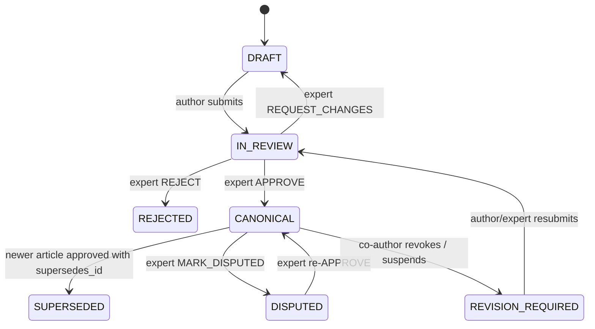

# Stage 4 — Governance Engine, Creator Consent (Exit Strategy) & Qdrant Index

**Goal:** only expert-approved, consent-active knowledge is retrievable. Authors can suspend,
resume or revoke their contributions, with immediate effect on retrieval.
**Spec refs:** `PLAN.md` Etap 4 · `AGENTS.md` §3.2 · `ARCHITECTURE.md` §2, §3, §4

---

## Chunk 4.1 — Qdrant collections, embeddings & vector repositories

**Client** `vector/client.py`: `qdrant-client` `AsyncQdrantClient(url=https…, api_key=…)`, TLS
verified against the dev CA in compose.

**Embeddings** `vector/embedding.py`: `LLMGateway.embed(..., force_local_llm=True)` with a local
multilingual model (e.g. `BAAI/bge-m3` or `intfloat/multilingual-e5-large` via Ollama/TEI).
Dimension comes from settings and is validated at startup against the collection config.

**Collections** (idempotent bootstrap `vector/collections.py`, run at startup / CLI):
| Collection | Vectors | Payload (indexed fields) |
|---|---|---|
| `private_notes_index` | dense, cosine | `user_id` (keyword, **`is_tenant=true`**), `note_id`, `derivative_id` |
| `canonical_wiki_index` | dense, cosine | `block_id`, `article_id`, `author_id` (keyword), `consent_status` (keyword), `is_active` (bool), `article_status` (keyword), `is_honeypot` (bool), `verified_at` |

- Payload indexes created for all filter fields, so filtered search stays fast.
- **No text in payloads** (overview §2.5). Point ID = `block_id` (UUID), which makes deletes and updates exact.

**Docker:**
- Collections and payload indexes are created idempotently by the `bootstrap` container service
  (`spoldzielnia bootstrap`) during `docker compose up`.
- `AsyncQdrantClient` connects to `https://qdrant:6333` on `backend`, with API key loaded from
  `/run/secrets/qdrant_api_key` and TLS verified against the internal CA volume.

**Repositories (the only access paths)**
- `PrivateVectorRepo(user_id)`: constructor requires `user_id`. **Every** search/upsert/delete injects
  `must: user_id == …`. No method without a tenant (gap G9). Used for "ask my notebook".
- `CanonicalVectorRepo`: every search **always** adds the mandatory filter
  `consent_status == ACTIVE AND is_active == true AND article_status == CANONICAL`, built in one
  function `active_canonical_filter()`. Callers can add filters, never remove them.

**Indexing tasks** (Celery `index` queue)
- `index_private_derivative(derivative_id, owner_id)`: chunk + embed + upsert into private index.
  Triggered after 2.5.
- `index_canonical_article(article_id)`: embed each block, upsert with the full payload (`wait=True`).

**Tests**
- Integration (Qdrant testcontainer): tenant filter isolation (user B search never returns A's points).
  The canonical filter excludes `SUSPENDED`, `REVOKED`, `is_active=false`, non-canonical points.
- Unit: `active_canonical_filter()` can't be overridden (caller-supplied `consent_status=SUSPENDED` is ANDed, not replaced).

---

## Chunk 4.2 — Expert review state machine & index synchronisation

**State machine** `wiki/governance.py`: explicit transition table, pure and fully unit-tested:

**Rules**
- Transitions to/from `CANONICAL` require `EXPERT` + MFA (1.6). A reviewer **cannot approve their own
  article** (no `author_id` of any block == reviewer).
- Optional quorum: `settings.review_quorum` (default 1) distinct expert approvals.
- `APPROVE` with `supersedes_id`: in **one DB transaction** set the new article `CANONICAL`, set the old one
  `SUPERSEDED` (`superseded_by_id`), write `ExpertReview`, set `last_verified_at`, and add outbox events.
- Leaving `CANONICAL` (→ SUPERSEDED / DISPUTED / REVISION_REQUIRED) sets `article_status` in Qdrant
  payloads (`set_payload` by `article_id` filter, `wait=True`). Entering `CANONICAL` triggers `index_canonical_article`.
- Optimistic locking (`version` column) so concurrent reviews don't clobber each other.

**API** (`api/wiki.py`, `api/reviews.py`)
- `GET /wiki/articles` (canonical only, for members), `GET /wiki/articles/{id}` (renders blocks with
  `consent_status=ACTIVE` only. Suspended blocks are shown as "content withheld by the author").
- `POST /wiki/articles/{id}/submit` (author).
- `GET /reviews/queue`, `POST /reviews/{article_id}` `{decision, comment, supersedes_id?}` (expert).
- Every transition is audited (`ARTICLE_STATUS_CHANGED` with from/to/actor).

> Note on anti-distillation: the Wiki read view returns article text to humans, which is a separate
> channel from RAG. It's covered by the frontend measures in Stage 6 and by `CoverageTracker`
> counting Wiki block views (5.2).

**Tests**
- Unit: exhaustive transition table (every invalid transition raises `InvalidTransition`).
- Integration: approve-with-supersede means the old article's vectors are absent from canonical search
  immediately after the HTTP response. DISPUTED does the same.
- Self-approval → 403. EXPERT without MFA → 403.

---

## Chunk 4.3 — Exit Strategy endpoints (suspend / resume / revoke)

**Endpoints** (`api/contributions.py`, authenticated member, acting only on their own blocks):
| Endpoint | Effect |
|---|---|
| `GET /me/contributions` | list articles + blocks authored, status, consent |
| `POST /me/contributions/suspend` `{article_ids?: list[UUID]}` | blocks → `SUSPENDED`; Qdrant `set_payload {consent_status: SUSPENDED, is_active: false}` filtered by `author_id` (+ `article_id ∈`) |
| `POST /me/contributions/resume` `{article_ids?}` (gap G7) | blocks → `ACTIVE`; Qdrant `is_active: true` **only if** article still `CANONICAL` |
| `POST /me/contributions/revoke` `{article_ids?, confirm: "REVOKE"}` | blocks → hard-deleted (content wiped; tombstone row with `consent_status=REVOKED`, `content=NULL` for audit integrity); Qdrant `delete` by filter `author_id` (+ `article_id ∈`) |

Scope defaults to **all** contributions when `article_ids` is omitted (gap G18). Revoke requires an
explicit confirmation field and a **recent authentication** (`auth_time` < 10 min, else step-up).

**Transaction order (consistency under failure)**
1. Begin DB tx. Lock affected blocks (`SELECT … FOR UPDATE`).
2. Update Postgres (`consent_status`, content wipe for revoke). Insert **outbox** rows (4.4).
3. Commit.
4. Synchronously apply the Qdrant operation with `wait=True` (bounded timeout). On success, mark the
   outbox rows done. On failure, leave them for the reconciler and **still** return success, because
   read-time re-validation (5.1) already excludes the blocks since Postgres is the source of truth.
5. Respond.

**Multi-author cascade** (`wiki/consent.py`)
- For each affected article with **other** authors whose status is `CANONICAL`, set
  `REVISION_REQUIRED`, set `is_active=false` for *all* its points (the whole article leaves RAG), and
  create a review queue item with the alert *"Wymagana rewizja – wycofano część wkładu autorskiego"*.
- Single-author article fully revoked: set `REJECTED`/archived and drop it from the Wiki listing.

**Audit:** `CONSENT_SUSPENDED`, `CONSENT_RESUMED`, `CONSENT_REVOKED`, `ARTICLE_DEGRADED`, each with
counts of blocks and points affected.

**Tests (mirror PLAN verification)**
- `test_coauthor_revoke_cascade` (integration, Postgres + Qdrant):
  1. Article X with blocks by A and B, approved `CANONICAL`, indexed.
  2. B calls `POST /me/contributions/revoke`.
  3. **Immediately after the response**: canonical search with a query matching B's block returns
     none of B's blocks **and none of A's blocks of article X**. Article X is `REVISION_REQUIRED`.
     B's block content is NULL in Postgres. B's points are gone from Qdrant (`retrieve` by ID → empty).
  4. Measure and assert propagation latency (`time from request start to Qdrant consistency < 1s` locally).
- Suspend → resume restores retrieval (article still canonical). Resume on a degraded article doesn't reactivate.
- A can't suspend B's blocks (scope enforcement).

---

## Chunk 4.4 — Outbox, reconciliation & propagation guarantees (gap G17)

- `vector_outbox` table: `id, op (UPSERT|SET_PAYLOAD|DELETE), filter_json, payload_json, status, attempts, created_at`.
- Celery beat task `reconcile_vector_outbox` every 30s retries pending ops with exponential backoff.
  Alert after N failures.
- Nightly `vector_consistency_audit`: scroll `canonical_wiki_index` and compare against Postgres.
  Any point whose block isn't `ACTIVE` + `CANONICAL` is fixed and reported (`VECTOR_DRIFT_DETECTED`).
- Metrics (Prometheus via `prometheus-fastapi-instrumentator`): `consent_propagation_seconds`, outbox
  backlog size.

**Docker:**
- Scheduled tasks run via the `beat` container service (`spoldzielnia beat`, using `api` image)
  attached only to `backend` network.
- `spoldzielnia reindex --yes` CLI command implemented to rebuild all Qdrant collections from
  scratch from Postgres data: `make reindex`, i.e. `docker compose run --rm worker-core reindex
  --yes`. It runs in `worker-core`, not `api`, because it needs the local embedding model and
  the KEK (private derivatives are decrypted to embed them).

**Tests**
- Simulated Qdrant outage during revoke: the API returns 200. Retrieval still excludes the blocks
  (Postgres re-validation). After Qdrant recovers, the reconciler deletes the points.
- Drift audit fixes a manually injected stale point.

**Stage 4 exit criteria:** cascade revocation test green with immediate non-retrievability. Governance
transition table fully covered. In Docker compose, `beat` and `worker-core` handle outbox reconciliation
cleanly with Qdrant over internal TLS.
