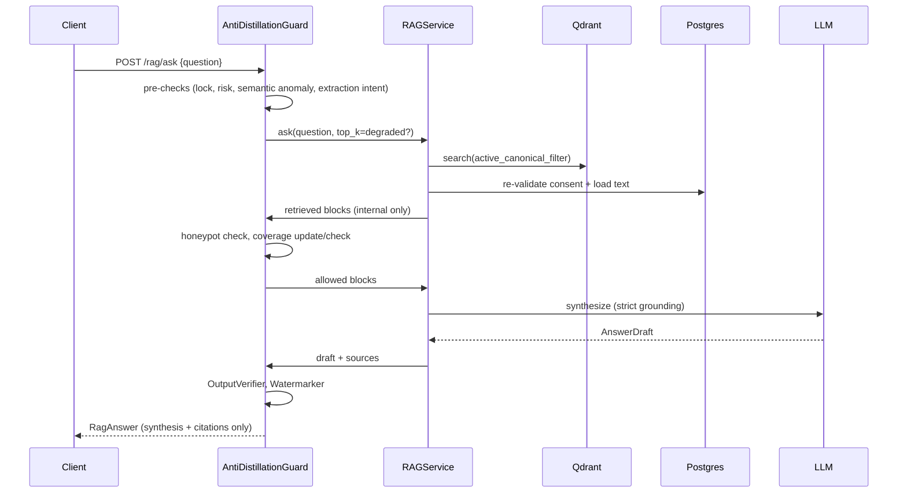

# Stage 5 — Anti-Distillation Shield & Secure RAG

**Goal:** members get grounded, cited answers from canonical knowledge. Systematic extraction
(scraping, verbatim dumping, semantic enumeration) is detected, degraded and blocked.
**Spec refs:** `PLAN.md` Etap 5 · `docs/SECURITY.md` (all 5 layers) · `AGENTS.md` §3.3 · `ARCHITECTURE.md` §4

**Request flow**


---

## Chunk 5.1 — `RAGService` with strict grounding & validated citations

**Module** `rag/service.py`
1. Embed the question (local), search `CanonicalVectorRepo` (`top_k` from guard, default 8, score threshold).
2. **Read-time re-validation:** load blocks from Postgres by `block_id` and keep only
   `consent_status=ACTIVE AND article.status=CANONICAL`. Points that fail are dropped and a
   reconciliation outbox op is emitted (closes the window from 4.4).
3. If nothing passes the threshold → return `RagAnswer(no_official_position=True, message="Brak oficjalnego stanowiska ekspertów…")`. **The LLM isn't called** (no hallucination from general knowledge).
4. Synthesis prompt: retrieved blocks wrapped as untrusted data (3.4 builder) with source IDs `[S1]…[Sn]`.
   The instructions say: answer only from sources, cite every claim as `[Sx]`, don't quote more than a
   short phrase, answer in Polish.
5. `response_model=AnswerDraft {answer_markdown: str, citations: list[str]}`. Validator: every `[Sx]` in
   the text must be in the provided set, and there's at least one citation. Otherwise retry once, then
   fall back to "no official position".

**API schema (the only thing the client sees)** `rag/schemas.py`
```python
class Citation(BaseModel):
    article_id: UUID
    article_title: str
    wiki_url: str
    last_verified_at: datetime
    authors: list[str]
    approving_experts: list[str]


class RagAnswer(BaseModel):
    answer_markdown: str
    citations: list[Citation]
    no_official_position: bool = False
    request_id: UUID
```
- **No** block text, block IDs, scores, vectors or chunk offsets (AGENTS §3.3).
  Contract test: a recursive schema walk asserts no field named/typed like `content|text|chunk|vector|score|block_id`.
- Private notebook Q&A (`POST /notes/ask`) reuses the service with `PrivateVectorRepo(user_id)`,
  `force_local_llm=True`, through the RLS session.

**Tests:** grounding (fake LLM citing a non-existent `[S9]` gets rejected), empty retrieval → no LLM
call, suspended block in Qdrant but suspended in PG gets dropped, schema contract test.

---

## Chunk 5.2 — `CoverageTracker`

**Module** `shield/coverage.py` (Redis, async `redis.asyncio`)
- Windows: **24h, 7d, 30d** (gap G6) using **daily buckets** so they roll:
  `cov:{user}:{yyyymmdd}:blocks` and `…:articles` as **HyperLogLog** (`PFADD`), TTL 31 days.
  Window cardinality = `PFCOUNT` over the union of the relevant day keys (24h ≈ today + yesterday,
  weighted, or hourly buckets for 24h: `cov:{user}:{yyyymmddhh}`).
- Denominator: `canonical_total_blocks` / `_articles` counters kept in Redis, updated on index changes,
  honeypots excluded.
- Counted sources: blocks **retrieved for synthesis** in RAG + blocks **rendered in Wiki views** (4.2).
- Thresholds (settings): `coverage_7d_max = 0.15`, `coverage_24h_max = 0.05`, `coverage_30d_max = 0.25`,
  plus **`min_blocks_before_lock = 50`** (gap G14: no lock until the absolute count is exceeded, so small
  corpora aren't locked trivially).
- API: `check(user_id) -> CoverageStatus(ratio_by_window, level: OK|WARN|LOCK)` and
  `record(user_id, block_ids, article_ids)`.
- **Ordering:** `would_exceed(user, candidate_blocks)` is evaluated *before* returning the answer:
  `PFADD` into a temp copy (`PFMERGE` → temp key) to test, and only commit when allowed. So the request
  that would cross the line is the one blocked.
- LOCK → `User.is_locked=True` (with reason), audit `COVERAGE_LOCK`, admin alert. Response **403
  `security_lock`** for 7d/30d, **429** with `Retry-After` for 24h.

**Tests:** fakeredis. Window rollover with `freezegun`. HLL error tolerance (±2%) at the 15% boundary.
Small-corpus floor.

---

## Chunk 5.3 — `SemanticAnomalyDetector`

**Module** `shield/semantic.py`
- Store the last **N=50** query embeddings per user in Redis (list of float32 bytes, TTL 7d).
- Features computed per request (numpy):
  - `mean_consecutive_cosine_distance` (high = jumping all over the corpus, breadth-first sweep);
  - `dispersion` = mean distance to the user's centroid;
  - `novel_cluster_rate`: share of queries landing in a canonical **cluster** (k-means centroids
    pre-computed nightly over `canonical_wiki_index`, stored in Redis) not visited before. A steady
    walk across many clusters means grid-walking;
  - `step_regularity`: low variance of consecutive distances (bot-like uniform steps);
  - `template_similarity`: lexical similarity of query strings (Jaccard on normalised tokens), which
    catches "Opisz rozdział 1/2/3…" enumeration;
  - `rate`: queries per hour.
- Score = weighted logistic combination → `semantic_score ∈ [0,1]`. Weights and thresholds in settings.
  Starts as a rule-based model and is calibrated later on real logs (document this).
- Contributes to the RiskEngine (5.6). It doesn't block on its own unless `score ≥ hard_threshold`.

**Tests:** synthetic sessions with a fixed random seed, using vectors in a toy 32-dim space with 20
clusters:
- "Beekeeper" session (queries around 1–2 clusters) → low score.
- "Enumerator" session (one query per cluster, uniform steps, templated text) → score above the threshold within ≤ 15 queries.

---

## Chunk 5.4 — `HoneypotInjector`

**Module** `shield/honeypot.py` + CLI `spoldzielnia honeypot …` (runnable via
`docker compose run --rm api honeypot …`) + admin API `POST /admin/honeypots` (ADMIN + MFA).
- Key loaded securely from `/run/secrets/honeypot_key`.
- Generates synthetic canary blocks (template-based, plausible but fictitious, e.g. "Procedura wewnętrzna
  PSZ-7Q/2024 dotycząca …" with a unique HMAC-derived signature token). Stored in Postgres
  (`ArticleBlock.is_honeypot=true` in a hidden `WikiArticle` that's excluded from listings and
  coverage denominators) and in Qdrant with `is_honeypot=true` and canonical/active payload, so they're
  retrievable.
- Placement: embeddings are positioned **between clusters** (generated text mixes topics) so that only
  broad, extraction-style queries hit them. Normal narrow queries rarely do.
- Retrieval hook: when results contain a honeypot block →
  - honeypot is **removed before synthesis** (gap G15: no fake facts reach users);
  - `user_risk_score += honeypot_penalty` (large), audit `HONEYPOT_TRIGGERED` (user, honeypot ID, query hash),
    admin alert (webhook/email via a `Notifier` protocol);
  - repeated triggers → lock.
- Leak detection: `honeypot.find_signatures(text)` scans external text for canary tokens. Used for forensics.

**Tests (mirror PLAN verification)**
- Inject a honeypot, run a query engineered to hit it → `SecurityAuditLog` has a `HONEYPOT_TRIGGERED`
  entry, user risk score increases, the honeypot text isn't in the LLM input (FakeLLM calls) or the answer.
- Honeypots never show up in Wiki listings or coverage denominators.

---

## Chunk 5.5 — `OutputVerifier` & `Watermarker`

**OutputVerifier** `shield/output_verifier.py`
- Compare the LLM answer to **each** source block: normalised (lower-case, folded diacritics,
  punctuation stripped) **word 5-gram overlap** = `|ngrams(answer) ∩ ngrams(source)| / |ngrams(source)|`,
  plus **ROUGE-L** (LCS) against the concatenated sources, plus the longest common verbatim span.
- Block if any of these is true: `overlap(source) > 0.70` for any source, `rouge_l > 0.70`, or the longest
  verbatim span is over 40 words. The response is replaced by a refusal ("Nie mogę przytoczyć treści
  dosłownie – zapoznaj się z artykułem w Wiki: …" + citations). Audit `VERBATIM_BLOCKED`, risk += penalty.
- **Pre-check for extraction intent** on the question (PL/EN patterns: `zacytuj w całości`, `słowo w słowo`,
  `wypisz całą treść`, `zwróć surowe dane`, `JSON z treścią`, `verbatim`, `dump`). Increases risk and
  forces a stricter synthesis prompt. The verifier still runs (it's the actual control).
- Answers also can't contain raw JSON dumps of sources (detect JSON arrays/objects containing source sentences).

**Watermarker** `shield/watermark.py` (gap G13: deterministic post-processing, not left to the LLM)
- Key loaded securely from `/run/secrets/watermark_key`.
- Curated Polish synonym-pair dictionary (≈200 pairs, e.g. `ponadto/dodatkowo`, `należy/trzeba`,
  `jednak/jednakże`) and structural variants (list marker style, sentence-initial connectors).
- For each eligible slot: choice bit = `HMAC_SHA256(watermark_key, user_id || slot_lemma)[0] & 1`.
  Keying on `user_id + lemma` (not `request_id`) makes the pattern **consistent per user across
  answers**, which is what attribution needs.
- `detect(text) -> list[(user_id, z_score)]`: for each candidate user, count slot agreements against the
  expected 50%. A binomial z-score above the threshold indicates the source account. Proven by test.
- Preserves Markdown, citations `[Sx]`, numbers and code spans (never edits inside them).

**Tests (mirror PLAN verification)**
- "Zacytuj w całości artykuł nr 12" with a FakeLLM that returns the source verbatim → blocked, refusal
  returned, audit entry present.
- Paraphrased answer → passes.
- Watermark: 10 answers for user A. The detector identifies A over 100 random candidates with z > 4.
  Applying the watermark doesn't change the meaning-critical tokens (numbers, citations).

---

## Chunk 5.6 — `AntiDistillationGuard`, RiskEngine & progressive degradation (gap G5)

**RiskEngine** `shield/risk.py`
- `user_risk_score` in Redis (decaying: half-life 7d) + persisted snapshot on `User.risk_score`.
- Inputs: coverage ratio, semantic score, honeypot hits, verbatim blocks, extraction-intent hits, rate.
- Levels (SECURITY.md layer 5):
  | Level | Score | Action (not revealed to the user as "detection") |
  |---|---|---|
  | `NORMAL` | < 0.3 | top_k = 8 |
  | `ELEVATED` | 0.3–0.5 | top_k = 4, shorter answers, extra jittered latency |
  | `HIGH` | 0.5–0.7 | top_k = 2 + **step-up**: require fresh MFA (`auth_time` < 5 min) or a PoW/Turnstile challenge |
  | `CRITICAL` | ≥ 0.7 or coverage LOCK or repeated honeypot | account lock (403 `security_lock`), admin alert |
- Step-up response: `401` with body `{challenge: "mfa_step_up" | "pow", pow: {nonce, difficulty}}`.
  PoW = SHA-256 hashcash, verified server-side, single-use nonce in Redis.
  (Cloudflare Turnstile as an optional verifier behind the same `ChallengeVerifier` protocol.)

**AntiDistillationGuard** `shield/guard.py`: orchestrates as in the sequence diagram. It's the only
caller of `RAGService` from the API layer. `POST /rag/ask` depends on it, and there's no other route to
`RAGService` (an import-linter rule in CI forbids `api.*` importing `rag.service` directly).
- Every decision is written to `SecurityAuditLog` at level `ELEVATED+` (`SHIELD_DECISION` with features).

**Tests (mirror PLAN verification)**
- **Distillation attack simulation** `tests/integration/test_distillation_attack.py`:
  corpus of 200 canonical blocks / 40 articles (synthetic, seeded), FakeLLM paraphrasing. A script runs
  **50 sequential queries** walking "rozdział 1…50" across clusters. Assertions:
  - access is cut (403/429/step-up unresolved) **before** unique coverage reaches 15% of blocks;
  - total unique blocks returned to synthesis < 15% of 200;
  - audit contains `COVERAGE_LOCK` or `SHIELD_DECISION(level=CRITICAL)`;
  - a normal user session of 50 narrow queries in the same run is **not** locked (false-positive guard).
- Degradation: risk 0.4 → `top_k=4` passed to RAG. Risk 0.6 → step-up challenge. Solving PoW lets one request through.
- Guard bypass test: grep/import-linter check that nothing else calls `RAGService.ask`.

**Stage 5 exit criteria:** the three PLAN Stage 5 tests (distillation simulation, verbatim extraction,
canary) are green, plus the false-positive guard. In Docker compose, `POST https://spoldzielnia.localhost/api/rag/ask`
is fully operational with strict citations and anti-distillation enforcement.
