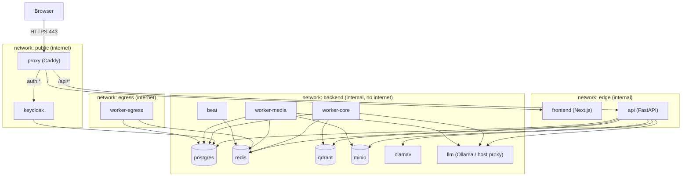

# Spółdzielnia AI — Docker Deployment Architecture

**Decision (agreed):** the platform runs as a **web app made of several images, started with one
`docker compose up`**. All infrastructure (Postgres, Qdrant, Redis, Keycloak, ClamAV, MinIO, LLM)
runs as containers in the same compose project. Docker is the runtime **from Stage 1**. Every
chunk keeps the stack bootable.
**Environments:** development on **macOS (Apple Silicon, Docker Desktop)**, production on a
**single Linux server** (amd64, optional NVIDIA GPU).

---

## 1. Topology



- **Single public entry point:** only `proxy` publishes ports (80/443). Everything else is
  reachable only on Docker networks.
- `edge` and `backend` are both declared `internal: true`, so containers on them **can't reach the
  internet**. That covers the API process (SSRF defence in depth, 2.4) and the ML/media workers
  (network isolation required by PLAN Etap 2).
- Only these touch internet-capable networks: `proxy` (`public` + `edge`; not attached to
  `backend`), `keycloak` (`public` + `backend`, for brokering Google
  Workspace / Entra ID), `clamav` (`backend` + `egress`, signature updates via `freshclam`) and
  `worker-egress` (`backend` + `egress`, SSRF-protected link fetching).
- **External IdPs are brokered by Keycloak.** `api` only ever talks to Keycloak (through the proxy
  alias), so it needs no internet. If the optional cloud LLM route (ARCHITECTURE §1) is enabled
  later, it goes through an explicit egress allow-list proxy, not by opening `edge`.

---

## 2. Images

All application images are built from this repo. Third-party images are **pinned by digest**
(Renovate/Dependabot updates them).

| Image | Source | Base | Contents | Runs as |
|---|---|---|---|---|
| `spoldzielnia/api` | `docker/backend.Dockerfile` target `api` | `python:3.12-slim-bookworm` | app + core deps, `libmagic1` | uid 10001 |
| `spoldzielnia/worker-core` | same file, target `worker-core` | `api` stage | + extra `ml`: Presidio, spaCy `pl_core_news_lg` (wheel), LLM-Guard | uid 10001 |
| `spoldzielnia/worker-media` | same file, target `worker-media` | `api` stage | + extra `media`: faster-whisper, Docling, PyMuPDF, `ffmpeg` | uid 10001 |
| `spoldzielnia/frontend` | `frontend/Dockerfile` | `node:22-alpine` (build) → `gcr.io/distroless/nodejs22` (run) | Next.js `output: "standalone"` | nonroot |
| `caddy` | official, Caddyfile mounted | — | reverse proxy + automatic HTTPS | caddy |

The same `api` image is reused for the `migrate`, `bootstrap`, `worker-egress` and `beat` services
with different commands. Splitting ML deps into separate targets keeps the API image small and
keeps heavy ML libraries out of the internet-facing process.

**Python extras** (`pyproject.toml`, added with `uv add --optional ml …` / `--optional media …`):
the API image installs no extras, workers install theirs. Local dev runs `uv sync --all-extras`
so `pyright` sees everything.

**Backend Dockerfile sketch**
```dockerfile
# syntax=docker/dockerfile:1.7
FROM python:3.12-slim-bookworm AS python-base
ENV PYTHONDONTWRITEBYTECODE=1 PYTHONUNBUFFERED=1 PATH="/app/.venv/bin:$PATH"
RUN apt-get update && apt-get install -y --no-install-recommends libmagic1 tini \
 && rm -rf /var/lib/apt/lists/* && useradd -u 10001 -m app
WORKDIR /app

FROM python-base AS builder
COPY --from=ghcr.io/astral-sh/uv:<pinned> /uv /bin/uv
ENV UV_COMPILE_BYTECODE=1 UV_LINK_MODE=copy UV_PYTHON_DOWNLOADS=never
ARG EXTRAS=""
RUN --mount=type=cache,target=/root/.cache/uv \
    --mount=type=bind,source=uv.lock,target=uv.lock \
    --mount=type=bind,source=pyproject.toml,target=pyproject.toml \
    uv sync --locked --no-dev --no-install-project $EXTRAS
COPY src ./src
COPY alembic.ini ./
RUN --mount=type=cache,target=/root/.cache/uv \
    --mount=type=bind,source=uv.lock,target=uv.lock \
    --mount=type=bind,source=pyproject.toml,target=pyproject.toml \
    uv sync --locked --no-dev --no-editable $EXTRAS

FROM python-base AS api
COPY --from=builder --chown=app /app /app
USER app
ENTRYPOINT ["tini", "--", "spoldzielnia"]
CMD ["api"]
# worker-core / worker-media: separate builder invocations with EXTRAS="--extra ml" / "--extra media"
# (+ apt ffmpeg for media), produced via docker-bake.hcl targets.
```

**Single CLI entrypoint** `spoldzielnia` (`[project.scripts]`), typed subcommands:
`api`, `migrate`, `bootstrap`, `worker --queues …`, `beat`, `audit-verify`, `honeypot …`,
`models download`, `reindex`.

---

## 3. Compose Files & Profiles

| File | Purpose |
|---|---|
| `compose.yaml` | Base stack, prod-like defaults, no published ports except proxy |
| `compose.dev.yaml` | Mac dev: `build:` contexts, `develop.watch` hot reload, debug ports on `127.0.0.1`, Keycloak `start-dev`, test realm users, Mailpit, `llm` = proxy to host Ollama |
| `compose.prod.yaml` | Linux server: `image:` tags from registry (no build), ACME TLS, `restart: unless-stopped`, resource limits, log rotation, `llm` = Ollama container |
| `compose.gpu.yaml` | NVIDIA GPU reservations for `llm` and `worker-media` (Linux only) |
| `docker-bake.hcl` | Build all targets; multi-arch `linux/amd64,linux/arm64` |

Profiles: `tools` (`models-init`, `mailpit`), `ops` (`backup`), `observability` (optional later).

Usage (wrapped in `Makefile`):
```bash
make up        # docker compose -f compose.yaml -f compose.dev.yaml up -d --wait
make watch     # docker compose ... watch   (hot reload of src/ and frontend/)
make smoke     # infra/scripts/smoke.sh against https://spoldzielnia.localhost
make deploy VERSION=v1.0.0   # prod: pull, migrate, up (run on server)
```

**Services**
| Service | Image | Networks | Depends on | Volumes |
|---|---|---|---|---|
| `proxy` | caddy | public, edge | api, frontend, keycloak | `caddy_data`, `caddy_config` |
| `frontend` | spoldzielnia/frontend | edge | — | — |
| `api` | spoldzielnia/api | edge, backend | migrate ✔, redis, qdrant, minio, clamav | — |
| `migrate` | spoldzielnia/api `migrate` | backend | postgres | — (one-shot) |
| `bootstrap` | spoldzielnia/api `bootstrap` | backend | migrate ✔, qdrant, minio | — (one-shot: buckets, Qdrant collections) |
| `worker-core` | spoldzielnia/worker-core | backend | redis, postgres, llm | `models:ro` |
| `worker-media` | spoldzielnia/worker-media | backend | redis, postgres, minio, llm | `models:ro` |
| `worker-egress` | spoldzielnia/api `worker -Q egress.fetch` | backend, egress | redis | — |
| `beat` | spoldzielnia/api `beat` | backend | redis | — |
| `postgres` | postgres:16 | backend | — | `pgdata` |
| `redis` | redis:7 | backend | — | `redisdata` |
| `qdrant` | qdrant/qdrant | backend | — | `qdrantdata` |
| `minio` | minio/minio | backend | — | `miniodata` |
| `clamav` | clamav/clamav | backend (+ egress for `freshclam` updates) | — | `clamavdb` |
| `keycloak` | keycloak | public, backend | postgres | — (state in Postgres DB `keycloak`) |
| `llm` | dev: `alpine/socat` → host Ollama · prod: `ollama/ollama` | backend (+ `host-llm` bridge in dev only) | — | `ollama` (prod) |
| `models-init` | spoldzielnia/worker-media `models download` | egress | — | `models` (rw) |

✔ = `condition: service_completed_successfully`. All others use `condition: service_healthy`.

---

## 4. Single Origin, HTTPS & OIDC Hostnames

- **HTTPS everywhere, including dev.** `__Host-` cookies with `Secure` (1.6) require HTTPS. Caddy uses
  `tls internal` in dev (`https://spoldzielnia.localhost`, `https://auth.spoldzielnia.localhost`;
  `*.localhost` resolves to 127.0.0.1 in browsers). `make trust-cert` installs Caddy's local root
  CA into the macOS keychain. In prod, Caddy gets Let's Encrypt certificates automatically.
- **Routing (Caddyfile):** `handle_path /api/*` → `api:8000` (prefix stripped; FastAPI uses
  `root_path="/api"` so OpenAPI URLs are right). Everything else → `frontend:3000`.
  `auth.<domain>` → `keycloak:8080`, and Keycloak's `/admin` is restricted to an IP allow-list.
  Upload size limit set in Caddy (`request_body max_size`) to match 2.2.
- **Same origin for UI and API.** Caddy is the only router (no Next.js rewrites needed), so cookies
  stay `SameSite=Strict` and CSRF/Origin checks are simple.
- **OIDC issuer split-horizon fix:** the browser and the `api` container must use the **same issuer
  URL**. `proxy` gets the network alias `auth.<domain>` on `edge`, so `api` resolves the public
  issuer hostname to Caddy internally (no internet and no hairpin NAT needed). In dev, `api` trusts
  Caddy's local root CA for the OIDC HTTP client only (`OIDC_CA_BUNDLE`, read-only mount from
  `caddy_data`).
- **Client IPs:** uvicorn runs with `--proxy-headers --forwarded-allow-ips=<edge subnet>`. `edge`
  has a fixed subnet so only Caddy's `X-Forwarded-For` is trusted (matters for audit log and rate limits).

---

## 5. Configuration & Secrets

- Non-secret config: `.env` (dev template `.env.example`), mapped to `Settings`.
- Secrets: **Docker secrets** (files mounted at `/run/secrets/<name>`). `Settings` uses
  `secrets_dir="/run/secrets"`. Never put secrets in environment variables or image layers.
- `infra/scripts/init-secrets.sh` generates random values into `./secrets/` (gitignored, mode 600):
  `pg_owner_password`, `pg_app_password`, `pg_keycloak_password`, `redis_password`,
  `qdrant_api_key`, `minio_root_password`, `oidc_client_secret`, `kek` (notebook encryption, 2.1),
  `watermark_key` (5.5), `honeypot_key` (5.4), `session_secret`.
- Postgres init (`infra/postgres/init/*.sh`) reads the secret files and creates roles
  `spoldzielnia_owner`, `spoldzielnia_app` (`NOBYPASSRLS`), `keycloak`, plus databases.

---

## 6. Models & Local LLM (Mac vs Linux)

| Concern | Mac dev | Linux prod |
|---|---|---|
| Chat/VLM/embeddings | **Native Ollama on macOS** (Metal GPU). The `llm` service is a socat proxy to `host.docker.internal:11434`, so containers always call `http://llm:11434` | `ollama/ollama` container on `backend`, GPU via `compose.gpu.yaml` |
| Model sizes | small (e.g. Bielik 4.5B / Qwen2.5-3B, `bge-m3`), whisper `small` int8 | Bielik 11B (or similar), whisper `large-v3` |
| Whisper / Docling / LLM-Guard weights | `models` volume filled by `make models` (`models-init`, profile `tools`) | same, pinned revisions + SHA-256 |
| spaCy `pl_core_news_lg` | wheel locked in `uv.lock`, baked into `worker-core` image | same |

Docker Desktop on macOS **has no GPU passthrough**. That's why dev uses host Ollama. The proxy
design means the app config is identical in both environments. Workers run with
`HF_HUB_OFFLINE=1`, `TRANSFORMERS_OFFLINE=1` and read models from `/models` (read-only).

**Docker Desktop resources (Mac):** allocate **≥ 12 GB RAM** (16 GB recommended) and ≥ 60 GB disk.
Rough usage: ClamAV 1.5–3 GB, worker-core 2–3 GB, worker-media 2–4 GB, Keycloak ~0.8 GB, rest ~1.5 GB.

---

## 7. Container Hardening Baseline (applied via YAML anchor to every app service)

```yaml
x-hardening: &hardening
  read_only: true
  tmpfs: ["/tmp:size=256m"]
  cap_drop: [ALL]
  security_opt: ["no-new-privileges:true"]
  pids_limit: 512
  init: true
  logging: { driver: json-file, options: { max-size: "20m", max-file: "5" } }
```
- Non-root users in all app images. No Docker socket mounts. No `privileged`.
- Healthchecks on every service. `depends_on` uses health conditions.
- Images scanned with `trivy`. SBOM + provenance via `docker buildx bake --sbom=true --provenance=true` (6.7).
- Prod: a host firewall `DOCKER-USER` rule blocks the `egress` network from reaching private ranges
  (defence in depth for the SSRF filter in 2.4).

---

## 8. Development Workflow on macOS

1. `brew install --cask docker` (or OrbStack), `brew install uv ollama mkcert`, then `ollama pull <dev models>`.
2. `make secrets && make up && make trust-cert && make models`.
3. Open `https://spoldzielnia.localhost`. Log in with Keycloak test users (`member1`, `expert1` …).
4. `make watch`: `docker compose watch` syncs `src/` (uvicorn `--reload`) and `frontend/` (`next dev`).
   This is faster on macOS than bind mounts.
5. The quality gates (`ruff`, `pyright`, `pytest`) still run **on the host via `uv`**, as in
   `AGENTS.md`. Integration tests keep using testcontainers (independent of the running stack).

---

## 9. Production on a Linux Server

**Prerequisites:** Docker Engine ≥ 24 + compose v2, DNS `A` records for `<domain>` and
`auth.<domain>`, ports 80/443 open. Optional: NVIDIA driver + NVIDIA Container Toolkit.

**Build & ship:** CI runs `docker buildx bake --push` (multi-arch) to a registry (default: GHCR),
tagged `sha-<commit>` and `vX.Y.Z`. Fallback for an offline server: `docker save | ssh … docker load`.

**Deploy / upgrade** (`make deploy VERSION=…`, `infra/scripts/deploy.sh`):
1. `docker compose -f compose.yaml -f compose.prod.yaml [-f compose.gpu.yaml] pull`
2. `… run --rm migrate` (Alembic, owner role). Migrations follow **expand/contract** so the previous
   version still runs against the new schema, which makes rollback a simple image re-tag.
3. `… up -d --wait`, then `make smoke` against the public domain.

**Backups** (`backup` service, profile `ops`, nightly via host cron/systemd timer):
- `pg_dump -Fc` for the `spoldzielnia` and `keycloak` databases, `mc mirror` of MinIO, `age`-encrypted,
  copied off-site.
- Qdrant is **derivable** from Postgres (`spoldzielnia reindex`). Snapshots are optional and only
  speed up recovery.
- The `kek` secret is backed up **separately** (encrypted notebooks are unreadable without it).
- After restore: `spoldzielnia audit-verify` (hash chain) + vector consistency audit (4.4).

---

## 10. CI (GitHub Actions)

| Job | Steps |
|---|---|
| `quality` | `uv sync --all-extras` → ruff → pyright → pytest (unit) |
| `integration` | pytest `-m integration` (testcontainers) |
| `docker` | `docker buildx bake` (amd64 on PRs, multi-arch on `main`) → `docker compose up --wait` → `smoke.sh` |
| `e2e` (Stage 6) | Playwright against the compose stack |
| `security` (Stage 6) | trivy images, pip-audit, bandit, npm audit, gitleaks |

---

## 11. Open Questions

- Production **domain name** (needed for Caddy/Keycloak hostnames).
- **Registry:** GHCR OK, or a private registry / offline transfer?
- Server **GPU** model/VRAM (decides the production LLM size).
- **Off-site backup target** (S3-compatible bucket, NAS, …).
